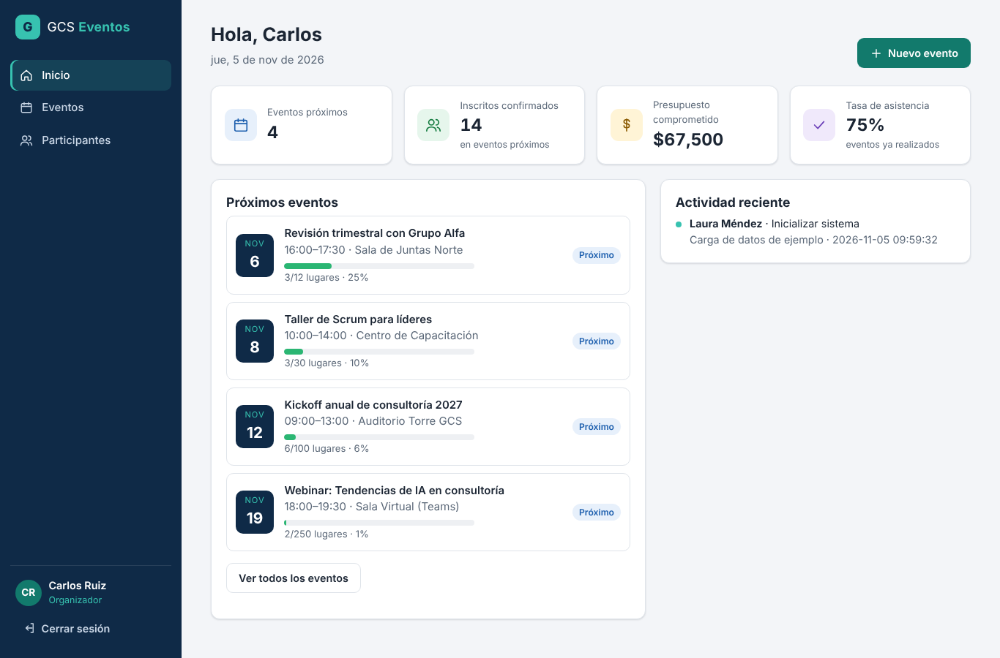
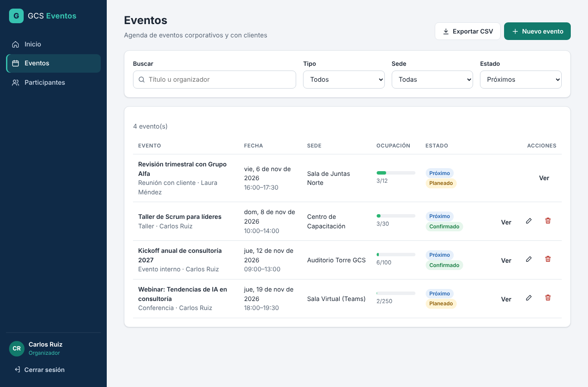
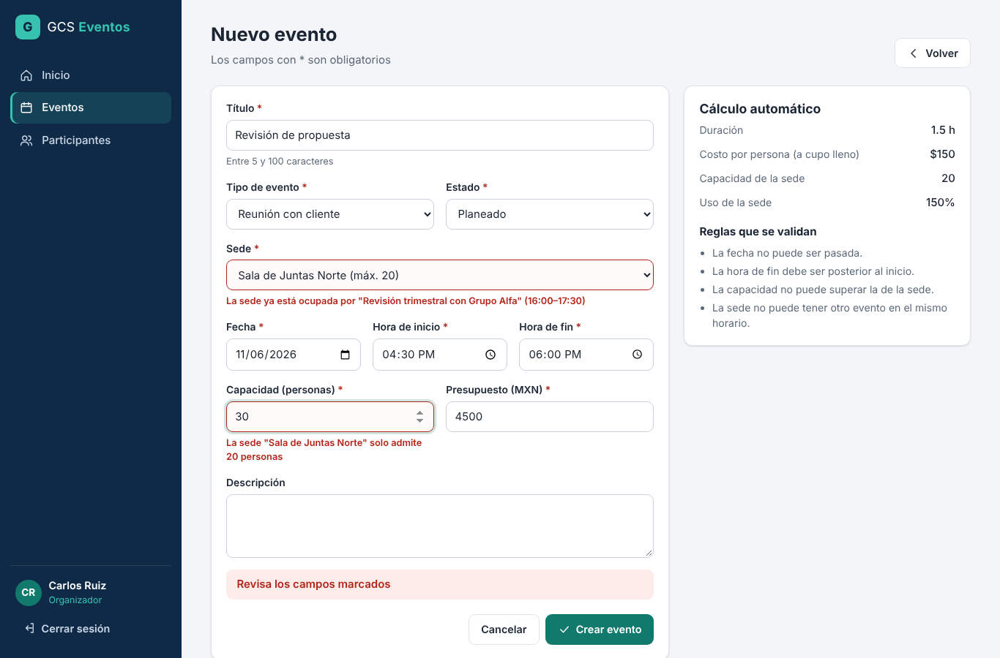
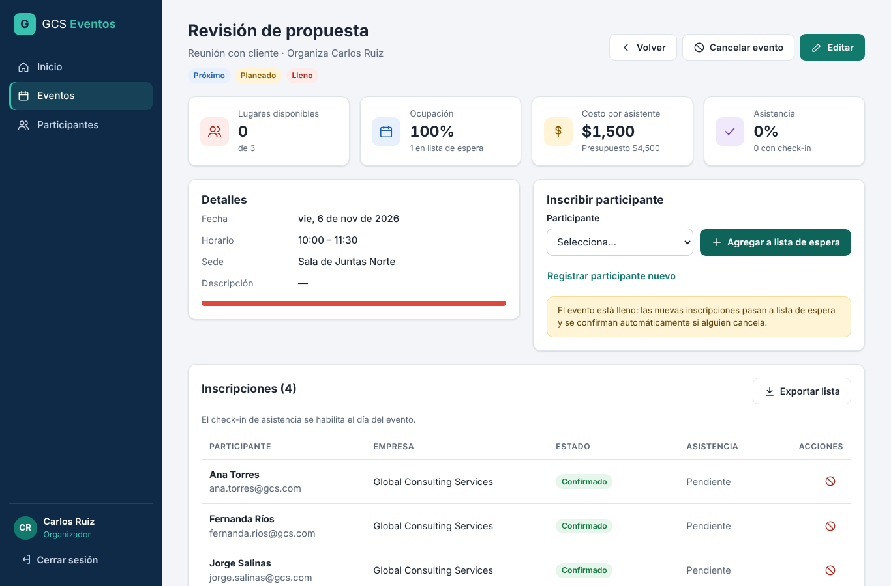

# GCS Eventos — Sistema de gestión de eventos

Prototipo funcional para **Global Consulting Services (GCS)**, desarrollado por el Equipo 1 para la Actividad 3 de *Metodologías ágiles* (Universidad Tecmilenio).

> Con autorización del profesor, todo lo que la actividad pedía hacer en **Mendix** se hizo en **GitHub**:
>
> | En Mendix | En este repositorio |
> |---|---|
> | Plataforma de gestión de proyectos (backlog) | GitHub **Issues** + **Projects** · [`docs/product-backlog.md`](docs/product-backlog.md) |
> | Studio Pro: páginas | Pantallas en [`js/app.js`](js/app.js) |
> | Building blocks / snippets | Componentes reutilizables en [`js/components.js`](js/components.js) |
> | Microflows y validaciones | Reglas de negocio en [`js/rules.js`](js/rules.js) |
> | Domain Model | Base de datos SQLite en [`database/schema.sql`](database/schema.sql) · [diagrama ER](database/diagrama-er.md) |
> | Widgets y estilos (Atlas UI) | Sistema de diseño en [`css/styles.css`](css/styles.css) |
> | Roles de seguridad | Roles Administrador, Organizador y Colaborador |

## Actividad 4: tareas, comunicación y componentes reutilizables

| Entregable | Dónde |
|---|---|
| Definición del producto, decisiones y retos | [`docs/actividad-4.md`](docs/actividad-4.md) |
| Modelo de datos con Evento, Asistente y Tarea (ERD) | [`database/diagrama-er.md`](database/diagrama-er.md) |
| Microflujos modulares y reutilizables (con diagramas) | [`docs/microflujos.md`](docs/microflujos.md) |
| Componentes reutilizables (calendario, formulario de asistentes…) | [`docs/componentes-reutilizables.md`](docs/componentes-reutilizables.md) |
| Reporte de pruebas (60 casos) | [`docs/reporte-pruebas.md`](docs/reporte-pruebas.md) |
| Capturas de las pantallas nuevas | [`docs/capturas-a4/`](docs/capturas-a4) |

Pantallas nuevas:
- **Tareas**: seguimiento de progreso.
- **Comunicación**: bandeja, comunicados y avisos.
- **Detalle del evento**: pestañas Asistentes, Tareas y Comunicación.
- **Vista calendario** de la agenda.
- **Portal del asistente** (`#/portal/…`).
- **Auto-registro público** (`#/registro/…`).

En la pantalla de login, "Usuarios de prueba" incluye los enlaces al portal y al auto-registro de ejemplo.

## 1. Definición del producto

**Problema.** GCS organiza cada mes capacitaciones, talleres, conferencias y reuniones con clientes. Hoy los coordina con hojas de cálculo y correos, y eso provoca:
- Dos eventos reservados en la misma sala y a la misma hora.
- Eventos con más inscritos que lugares, o lugares vacíos porque nadie gestiona las bajas.
- No saber quién asistió ni cuánto costó cada evento por persona.
- Ningún registro de quién modificó qué.

**Solución.** Una aplicación web donde los organizadores planean eventos validados contra la disponibilidad y la capacidad de cada sede. Los colaboradores inscriben participantes con control automático de cupo y lista de espera, y registran el check-in el día del evento. La dirección ve indicadores en un tablero.

**Beneficios.**
- Cero choques de agenda: la regla de traslape bloquea reservas duplicadas.
- Mejor aprovechamiento: la lista de espera llena automáticamente los lugares que se liberan.
- Decisiones con datos: ocupación, costo por asistente y tasa de asistencia calculados en automático.
- Seguridad y trazabilidad: acceso por roles, contraseñas cifradas con hash y bitácora de auditoría.
- Menos trabajo manual: listas de inscritos y reportes exportables a Excel (CSV).

## 2. Cómo usarlo

**En línea:** https://waddatony.github.io/gcs-eventos/

**Product Backlog (tablero):** https://github.com/users/Waddatony/projects/1 · [Issues](https://github.com/Waddatony/gcs-eventos/issues?q=is%3Aissue) · [Sprints (milestones)](https://github.com/Waddatony/gcs-eventos/milestones?state=all)

**En tu computadora:**
```bash
npm start          # abre http://localhost:8080
# o sin Node:  python -m http.server 8080
```
> Se debe abrir desde un servidor. Con doble clic al `index.html` no carga la base de datos.

**Usuarios de prueba** (también aparecen en la pantalla de login):

| Rol | Correo | Contraseña |
|---|---|---|
| Administrador | admin@gcs.com | Admin2026 |
| Organizador | organizador@gcs.com | Eventos2026 |
| Colaborador | colaborador@gcs.com | Staff2026 |

**Pruebas automáticas** de los microflujos (41 casos) y de interfaz (19 casos):
```bash
npm install && npm test
python -m http.server 8080 & python tests/e2e/interfaz_a4.py   # requiere: pip install playwright && playwright install chromium
```

## 3. Pantallas

| Pantalla | Historias | Qué hace |
|---|---|---|
| Login | HU-01 | Acceso por rol, bloqueo tras 5 intentos fallidos |
| Inicio (tablero) | HU-10 | 4 indicadores, próximos eventos con ocupación, actividad reciente, alerta de eventos casi llenos |
| Eventos | HU-04, HU-12 | Lista con búsqueda y filtros, ocupación, estados, exportar a CSV |
| Nuevo / editar evento | HU-02, HU-03, HU-08 | Formulario con validación en vivo y panel de cálculo automático |
| Detalle del evento | HU-06, HU-07, HU-09, HU-11 | Métricas, inscripción, lista de espera, check-in, cancelaciones |
| Participantes | HU-05 | Directorio con alta y edición en un modal reutilizable |
| Sedes | HU-13 | Catálogo de sedes con su capacidad (solo administrador) |
| Usuarios | HU-14 | Alta de usuarios, activar o desactivar, matriz de permisos |
| Bitácora | HU-15 | Auditoría completa, exportable |

### Capturas

| | |
|---|---|
|  |  |
|  |  |

Más capturas en [`docs/capturas/`](docs/capturas).

## 4. Reglas de negocio implementadas

**Validaciones**
- Título de 5 a 100 caracteres.
- Fecha no pasada.
- Hora de fin posterior a la de inicio.
- Capacidad entera mayor a 0 y menor o igual a la capacidad de la sede.
- Presupuesto mayor o igual a 0.
- Correo con formato válido y único.
- Teléfono de 10 dígitos.
- Contraseña de al menos 8 caracteres, con una mayúscula y un número.

**Agenda**
- Una sede no puede tener dos eventos activos que se traslapen en horario.

**Cupo**
- Si hay lugar, la inscripción queda **Confirmada**; si no, pasa a **Lista de espera** con su posición.
- Al cancelar una inscripción o ampliar la capacidad, se promueve automáticamente al siguiente de la lista.
- Un trigger en la base de datos impide el sobrecupo, aunque alguien se salte la interfaz.

**Ciclo de vida**
- No se puede inscribir a eventos cancelados o pasados.
- El check-in solo se registra el día del evento o después, y solo para confirmados.
- No se elimina un evento con confirmados: se cancela.
- No se reduce la capacidad por debajo de los confirmados.

**Permisos**
- El organizador solo edita o cancela sus propios eventos.
- Solo el administrador gestiona sedes y usuarios, consulta la bitácora y elimina participantes.

**Cálculos automáticos**
- Lugares disponibles, porcentaje de ocupación, costo por asistente, duración del evento y uso de la sede.
- Tasa de asistencia por evento y global.
- Estado temporal del evento: Próximo, Hoy o Finalizado.

## 5. Decisiones de diseño de interfaz

- **Navegación lateral fija** con íconos y texto. En celular se convierte en un menú desplegable para dejar espacio al contenido.
- **Paleta corporativa** azul marino con acento verde azulado. Los colores de estado (verde, amarillo, rojo, gris) mantienen el mismo significado en todas las pantallas.
- **Tarjetas de indicadores** arriba de cada pantalla clave, para que lo importante se vea primero.
- **Validación junto al campo** con mensajes claros en español. El panel de *cálculo automático* muestra el efecto de lo que se captura antes de guardar.
- **Confirmación antes de acciones destructivas** (eliminar o cancelar) con un modal propio.
- **Accesibilidad**:
  - Etiquetas en todos los campos y textos alternativos en los botones de solo ícono.
  - Navegación completa con teclado, enlace "Saltar al contenido" y foco visible.
  - Avisos leídos por lectores de pantalla (`aria-live`).
  - Contraste AA y respeto a `prefers-reduced-motion`.
- **Responsivo**: las tablas se transforman en tarjetas en pantallas angostas y los formularios pasan a una sola columna.

## 6. Estructura del repositorio

```
index.html              Punto de entrada
css/styles.css          Estilos y diseño responsivo
js/app.js               Enrutador y pantallas
js/components.js        Componentes reutilizables (botón, campo, formulario, tabla, KPI, modal, toast…)
js/rules.js             Reglas de negocio, permisos y cálculos
js/db.js                Acceso a datos (SQLite) y datos de ejemplo
js/security.js          Hash de contraseñas y escape de HTML
js/storage.js           Persistencia en IndexedDB
database/schema.sql     Esquema de la base de datos
database/diagrama-er.md Diagrama entidad-relación y medidas de integridad
docs/                   Backlog, plan de sprints y capturas
tests/                  Pruebas automáticas
vendor/                 sql.js (SQLite en WebAssembly, licencia MIT)
```
