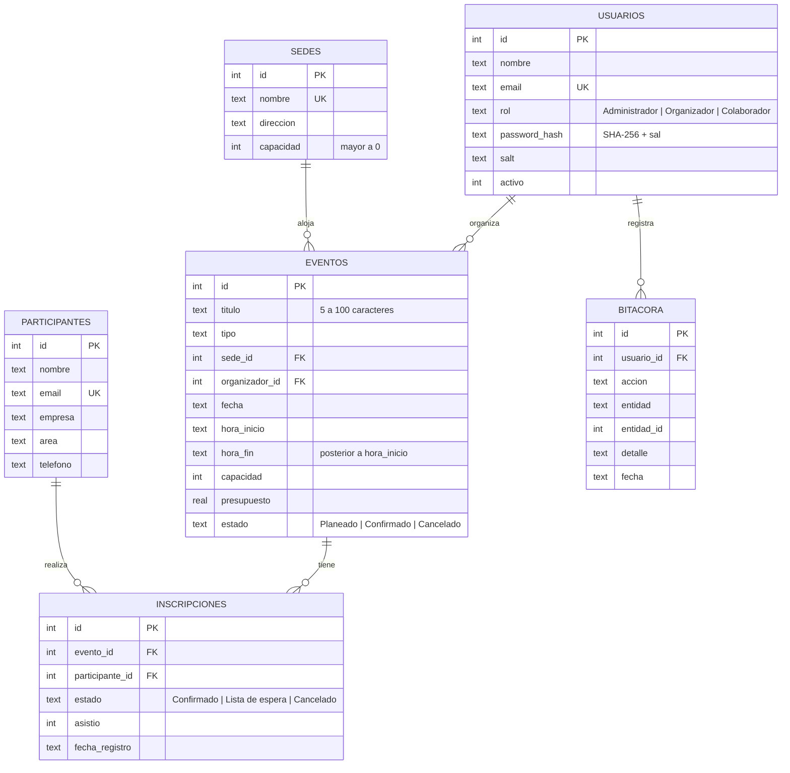

# Estructura de la base de datos

Motor: **SQLite** (ejecutado en el navegador con sql.js/WebAssembly). Esquema completo en [`schema.sql`](schema.sql).

## Integridad y seguridad de los datos

| Mecanismo | Dónde | Para qué |
|---|---|---|
| `PRIMARY KEY`, `FOREIGN KEY` con `PRAGMA foreign_keys = ON` | Todas las tablas | Relaciones válidas; no hay inscripciones sin evento |
| `ON DELETE CASCADE` / `RESTRICT` | inscripciones / eventos | Borrar un evento elimina sus inscripciones; no se puede borrar una sede en uso |
| `UNIQUE` | email de usuarios y participantes; (evento, participante) | Sin correos duplicados ni dobles inscripciones |
| `CHECK` | capacidad > 0, presupuesto ≥ 0, hora_fin > hora_inicio, valores de rol y estado | Datos válidos aunque se salte la interfaz |
| Trigger `trg_no_sobrecupo` | inscripciones | La BD rechaza más confirmados que la capacidad |
| Vista `v_eventos_resumen` | eventos | Cálculo centralizado de confirmados, lista de espera y asistentes |
| Índices | fecha, (sede, fecha), (evento, estado) | Búsquedas y validación de choques eficientes |
| Consultas parametrizadas (`?`) | `js/db.js` | Evitan inyección SQL |
| Transacciones (`BEGIN/COMMIT/ROLLBACK`) | `js/rules.js` | Cada operación se guarda completa o no se guarda |
| Hash SHA-256 + sal por usuario | usuarios | Contraseñas nunca en texto plano |
| Escape de HTML | `js/components.js` | Evita XSS al mostrar datos capturados |
| Bitácora | bitacora | Trazabilidad de quién hizo qué y cuándo |

**Almacenamiento:** el archivo SQLite completo se guarda en **IndexedDB** del navegador después de cada operación, así que los datos persisten al recargar o cerrar la app (base de datos local, según permite la actividad).
