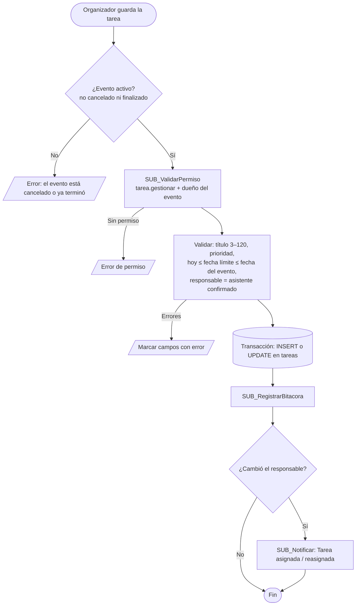
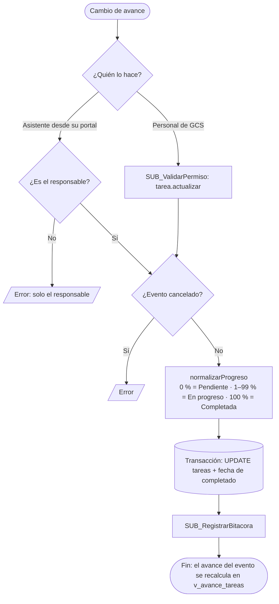
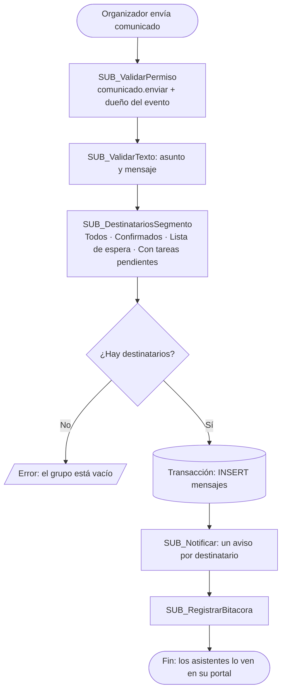
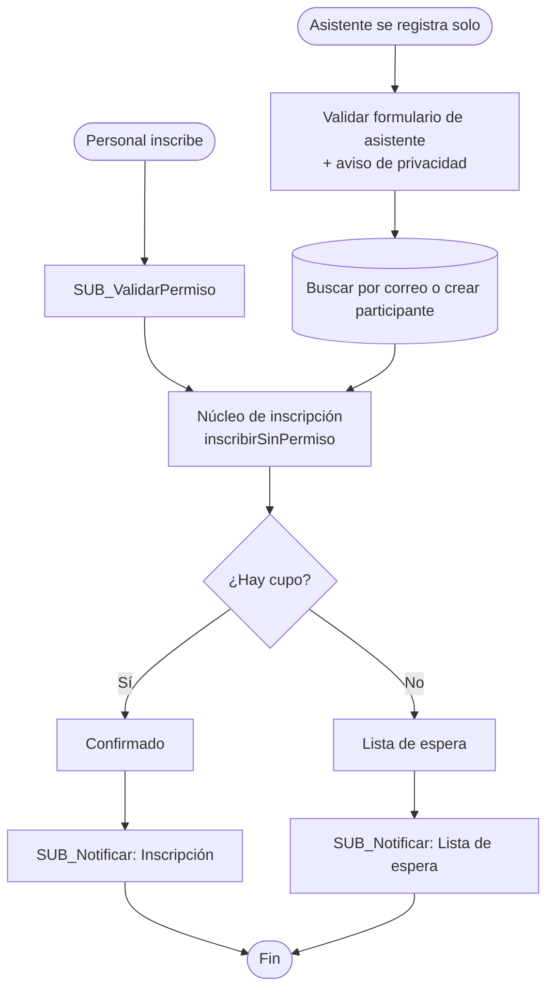

# Microflujos (lógica de negocio)

El profesor autorizó usar GitHub en lugar de Mendix. Por eso la lógica que en Mendix serían **microflows** está escrita como funciones de JavaScript con la misma estructura. Cada microflujo:

1. valida permisos;
2. valida los datos;
3. cambia la base de datos dentro de una **transacción**: se guarda todo o no se guarda nada;
4. registra en la bitácora;
5. avisa a los asistentes que corresponda.

Los pasos 1, 4 y 5 no se repiten en cada microflujo: son **sub-microflujos reutilizables**.

| Archivo | Contenido |
|---|---|
| [`js/subflujos.js`](../js/subflujos.js) | Sub-microflujos reutilizables |
| [`js/rules.js`](../js/rules.js) | Microflujos de eventos, inscripciones y participantes (Actividad 3, ahora con avisos) |
| [`js/microflujos.js`](../js/microflujos.js) | Microflujos de tareas, progreso, comunicación, portal y auto-registro (Actividad 4) |

## Sub-microflujos y dónde se reutilizan

| Sub-microflujo | Función | Lo usan |
|---|---|---|
| SUB_ValidarPermiso | `exigir()` / `puede()` | Todos los microflujos y todas las pantallas (para ocultar botones) |
| SUB_RegistrarBitacora | `registrarBitacora()` | Todos los microflujos que cambian datos |
| SUB_Notificar | `notificar()` | Inscribir, Promover lista de espera, Asignar tarea, Editar evento, Cancelar evento, Enviar comunicado (6 microflujos) |
| SUB_DestinatariosSegmento | `destinatariosPorSegmento()` | Enviar comunicado, Editar evento (aviso de cambio), Cancelar evento, botón "Abrir en mi correo" |
| SUB_ValidarTexto | `validarTexto()` | Asignar tarea, Enviar comunicado, Mensaje del asistente, Auto-registro |
| SUB_PromoverListaEspera | `promoverListaEspera()` | Cancelar inscripción, Editar evento (si sube la capacidad) |
| Núcleo de inscripción | `inscribirSinPermiso()` | Inscribir (personal de GCS) y Auto-registro (el propio asistente) |
| Consulta de tareas | `listarTareas()` + `resumenTareas()` | Pestaña Tareas del evento, pantalla Tareas, Inicio y Portal del asistente |
| Normalizar progreso | `normalizarProgreso()` | Actualizar progreso desde el sistema y desde el portal |

## Microflujos principales

Versiones en imagen para documentos: [`docs/diagramas/`](diagramas).

### MF_AsignarTarea — `guardarTarea()`

### MF_ActualizarProgresoTarea — `actualizarProgreso()`

### MF_EnviarComunicado — `enviarComunicado()`

### MF_InscribirAsistente — `inscribir()` / `autoRegistro()`

### MF_CancelarInscripcion — `cancelarInscripcion()`

Cancela la inscripción. Las tareas pendientes de esa persona en el evento quedan **sin asignar**. Luego llama a **SUB_PromoverListaEspera**, que confirma al siguiente de la lista y le manda un aviso de *Promoción*.

### MF_EditarEvento y MF_CancelarEvento

- Si cambia la fecha, la hora o la sede, **SUB_Notificar** avisa a todos los inscritos (*Evento modificado*).
- Si se cancela el evento, avisa a todos (*Evento cancelado*).
- Si sube la capacidad, se llama a **SUB_PromoverListaEspera**.

## Transacciones anidadas

Un microflujo puede llamar a otro: por ejemplo, Auto-registro llama al núcleo de inscripción. Por eso `Database.transaction()` ([`js/db.js`](../js/db.js)) admite anidarse. Solo la transacción exterior confirma o revierte, así que si falla un paso intermedio no queda nada guardado a medias. La prueba R-03 lo comprueba.
